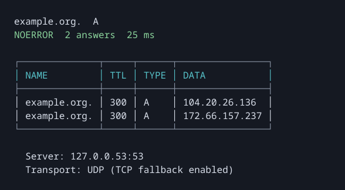
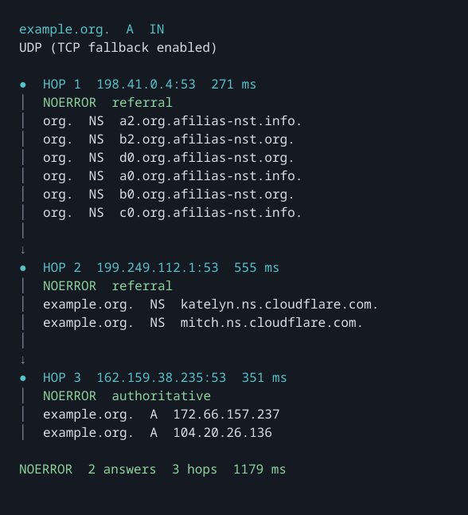

# digz

A DNS lookup tool written in Zig, powered by [ldns](https://github.com/NLnetLabs/ldns).
Colored tables and traces in the terminal. Plain text when redirected.

## Usage

```sh
digz example.org
```



```sh
digz example.org --trace
```



Run `digz --help` for all options.

## Build

Requires Zig 0.17.0, pkg-config, and OpenSSL 3 development headers and libraries.
Supports Linux and macOS on x86_64 and aarch64.

```sh
zig build -Doptimize=ReleaseFast
```

Binary: `zig-out/bin/digz`.

On macOS, install OpenSSL with Homebrew before building:

```sh
brew install openssl@3 pkgconf
export PKG_CONFIG_PATH="$(brew --prefix openssl@3)/lib/pkgconfig"
```

## Development

`mise install` · `mise run lint` · `zig build fmt` · `zig build test`
